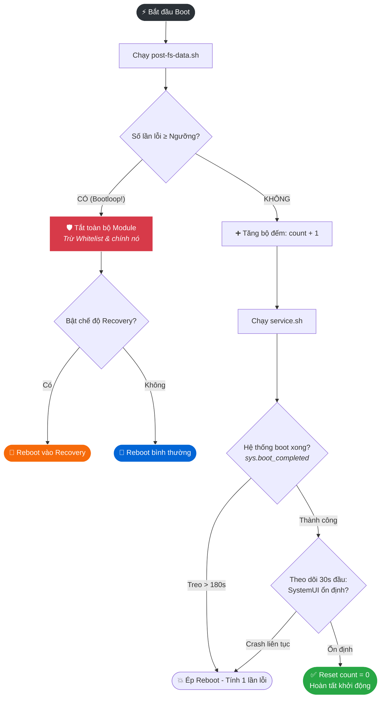
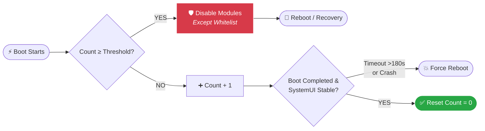

<div align="center">

<!-- Animated Header / Typing SVG -->
<a href="https://git.io/typing-svg">
  
</a>

<p align="center">
  <b>Tự động tắt toàn bộ module khi máy bị bootloop — có thể reboot thẳng vào recovery.</b><br>
  <i>Automatically disables all root modules when your device bootloops, with optional reboot to recovery.</i>
</p>

<!-- Badges -->
<p align="center">
  
  
  
  
  
  
</p>

<!-- Language Switcher Buttons -->
<p align="center">
  <a href="#-tiếng-việt">
    
  </a>
  &nbsp;&nbsp;
  <a href="#-english">
    
  </a>
</p>

</div>

<br>

---

# 🇻🇳 Tiếng Việt

<details>
<summary><b>📑 Mục lục nhanh (Nhấn để mở)</b></summary>

- [🌟 Giới thiệu](#-giới-thiệu)
- [✨ Tính năng nổi bật](#-tính-năng-nổi-bật)
- [📋 Yêu cầu hệ thống](#-yêu-cầu-hệ-thống)
- [📦 Hướng dẫn cài đặt](#-hướng-dẫn-cài-đặt)
- [🔍 Cơ chế hoạt động](#-cơ-chế-hoạt-động)
- [🖥️ Giao diện WebUI](#️-giao-diện-webui)
- [⚙️ Cấu hình nâng cao](#️-cấu-hình-nâng-cao)
- [🧪 Thử nghiệm Bootloop](#-thử-nghiệm-bootloop)
- [🆘 Khắc phục sự cố](#-khắc-phục-sự-cố)
- [📁 Cấu trúc thư mục](#-cấu-trúc-thư-mục)
- [🔒 Bảo mật & Giấy phép](#-bảo-mật--giấy-phép)

</details>

## 🌟 Giới thiệu

**Anti Bootloop** là chiếc "phao cứu sinh" dành cho thiết bị Android đã root. Khi một module xung đột làm máy khởi động lặp vô tận (bootloop), module này sẽ đếm số lần lỗi liên tiếp. Khi chạm ngưỡng bạn đặt, nó sẽ **tự động tắt tất cả module** (ngoại trừ các module an toàn nằm trong **Whitelist**) rồi **reboot** — hoặc đưa máy vào thẳng **Recovery** nếu bạn bật tùy chọn này.

Đi kèm với module là một **WebUI trực quan** giúp bạn cấu hình thông số, quản lý danh sách loại trừ (whitelist), khôi phục module và xem lịch sử cứu máy mà không cần đụng tới bất kỳ dòng lệnh nào.

---

## ✨ Tính năng nổi bật

<table>
  <tr>
    <td width="50%">
      <h3>🛡️ Bảo vệ Đa tầng</h3>
      <ul>
        <li><b>Đếm lỗi thông minh:</b> Tuỳ chỉnh ngưỡng kích hoạt từ <code>1</code> đến <code>5</code> lần boot lỗi liên tiếp.</li>
        <li><b>Nhận diện sâu:</b> Phát hiện cả lỗi treo logo quá lâu (<code>>180s</code>) hoặc vào được màn hình khoá nhưng <b>SystemUI bị crash</b>.</li>
        <li><b>Vào thẳng Recovery:</b> Tùy chọn tự động reboot vào TWRP/OrangeFox sau khi vô hiệu hoá các module gây hại.</li>
      </ul>
    </td>
    <td width="50%">
      <h3>🎛️ Quản lý Tiện lợi</h3>
      <ul>
        <li><b>Danh sách trắng (Whitelist):</b> Giữ cho các module thiết yếu không bao giờ bị tắt nhầm.</li>
        <li><b>Khôi phục 1-Chạm:</b> Bật lại toàn bộ module vừa bị tắt chỉ bằng một nút bấm trên WebUI.</li>
        <li><b>Cài đặt bằng phím cứng:</b> Chọn cấu hình ngay lúc flash bằng phím Âm lượng (Volume Keys).</li>
      </ul>
    </td>
  </tr>
  <tr>
    <td width="50%">
      <h3>🖥️ WebUI Hiện đại</h3>
      <ul>
        <li><b>Giao diện 3 Tab:</b> Nhật ký · Module · Cài đặt.</li>
        <li><b>Đa ngôn ngữ & Giao diện:</b> Hỗ trợ Tiếng Việt / Tiếng Anh cùng chế độ Sáng / Tối (Light/Dark mode).</li>
        <li><b>Hỗ trợ nút Action:</b> Tự mở trình duyệt với token bảo mật cho người dùng Magisk.</li>
      </ul>
    </td>
    <td width="50%">
      <h3>📜 Nhật ký Chi tiết</h3>
      <ul>
        <li><b>Lịch sử Timeline:</b> Ghi nhận thời점 xảy ra bootloop theo đúng múi giờ của điện thoại.</li>
        <li><b>Lưu trữ xoay vòng:</b> Giữ lại 10 file log của 10 lần khởi động gần nhất để dễ dàng bắt bệnh.</li>
      </ul>
    </td>
  </tr>
</table>

---

## 📋 Yêu cầu hệ thống

- 📱 Thiết bị Android đã root bằng **Magisk**, **KernelSU** hoặc **APatch**.
- 🛠️ Nên có **Custom Recovery** hoạt động tốt (TWRP, OrangeFox…) nếu bạn bật tính năng tự vào recovery.
- 🧩 Nút **Action** yêu cầu trình quản lý root bản mới có hỗ trợ `action.sh`. Để mở WebUI trực tiếp trong app, bạn cần dùng KernelSU/APatch hoặc ứng dụng ngoài như **WebUI-X**.

> [!WARNING]
> Module được phát triển gần đây và **chưa được kiểm thử rộng rãi trên mọi dòng máy**. Hãy thử nghiệm trước với ngưỡng thấp và đảm bảo bạn luôn có phương án dự phòng để truy cập vào recovery.

---

## 📦 Hướng dẫn cài đặt

1. Tải file `AntiBootloop_vX.X.zip` mới nhất tại mục Releases.
2. Mở **Magisk / KernelSU / APatch** ➔ **Modules** ➔ **Install from storage** ➔ chọn file zip.
3. Sử dụng **phím Âm lượng** theo hướng dẫn trên màn hình:

| Bước cài đặt | Thao tác phím cứng | Mặc định (sau 30s) |
| :--- | :--- | :---: |
| **1. Chọn số lần boot lỗi (1–5)** | 🔉 **Vol-** : Chuyển số tiếp theo (1 ➔ 5)<br>🔊 **Vol+** : Xác nhận chọn số đang hiện | `3 lần` |
| **2. Reboot vào Recovery khi lỗi?** | 🔊 **Vol+** : Có (Yes)<br>🔉 **Vol-** : Không (No) | `Có (Yes)` |

4. Nhấn **Reboot** để kích hoạt hệ thống bảo vệ.

---

## 🔍 Cơ chế hoạt động

Sơ đồ dưới đây mô tả luồng xử lý của **Anti Bootloop** trong mỗi chu kỳ khởi động:



> [!NOTE]
> - **Reboot thủ công không bị tính là lỗi:** Vì ngay khi máy vào màn hình chính ổn định, bộ đếm `count` đã được trả về `0`.
> - **Giữ nguyên trạng thái cá nhân:** Những module nào bạn đã chủ động tắt từ trước sẽ **không bị đụng tới** và cũng **không tự bật lại** khi bạn nhấn nút khôi phục.
> - **Ví dụ thực tế:** Với ngưỡng đặt là `3`, sau 3 lần khởi động thất bại liên tiếp, ngay đầu lần khởi động thứ `4`, module sẽ can thiệp tắt các module khác và khởi động lại máy.

---

## 🖥️ Giao diện WebUI

| Tab chức năng | Chi tiết tính năng |
| :---: | :--- |
| 📜 **Nhật ký** | Xem trạng thái bảo vệ hiện tại, lịch sử các lần cứu máy (dạng timeline), đọc log chi tiết của từng lần boot (hỗ trợ lọc file, tô màu cú pháp, sao chép nhanh). |
| 🧩 **Module** | Danh sách toàn bộ module trong máy, thanh tìm kiếm/lọc, công tắc **"Không bị tắt"** (thêm vào Whitelist), nút khôi phục nhanh các module vừa bị vô hiệu hoá. |
| ⚙️ **Cài đặt** | Tuỳ chỉnh ngưỡng lỗi (`1–5`), bật/tắt tự vào Recovery, chuyển đổi ngôn ngữ (`VI/EN`), nút reset bộ đếm thủ công và hướng dẫn tóm tắt. |

### 🚀 Cách mở WebUI:
- **Trên KernelSU / APatch:** Nhấn trực tiếp vào thẻ module trong danh sách.
- **Trên Magisk:** Bấm nút **Action** trên thẻ module ➔ Trình duyệt sẽ tự động mở địa chỉ nội bộ (`127.0.0.1`) kèm theo mã token ngẫu nhiên. *(Server sẽ tự động đóng sau 10 phút không hoạt động để tiết kiệm pin và bảo mật).*

---

## ⚙️ Cấu hình nâng cao

Toàn bộ dữ liệu cấu hình và nhật ký được lưu tại `/data/adb/anti_bootloop/` *(sẽ tự động xoá sạch khi bạn gỡ cài đặt module)*.

| Tên File / Thư mục | Mô tả chi tiết |
| :--- | :--- |
| `config.prop` | Lưu cấu hình: `threshold` (1–5), `recovery` (0/1), `lang` (`vi`/`en`), `whitelist` (ID cách nhau bởi dấu phẩy), `boot_timeout` (mặc định `180` giây), `stable_time` (mặc định `30` giây). |
| `state.prop` | Lưu trạng thái: `count` (số lần lỗi hiện tại), `last_trigger` (giờ UTC), `log_idx`. |
| `events.log` | Lịch sử các sự kiện kích hoạt cứu máy (lưu theo chuẩn UTC). |
| `logs/boot-N.log` | Nhật ký chi tiết của từng lần khởi động, tự động ghi đè xoay vòng tối đa 10 file. |
| `disabled.list` | Danh sách ID các module đã bị **Anti Bootloop** can thiệp tắt. |

> [!TIP]
> Bạn có thể tinh chỉnh thời gian chờ treo logo (`boot_timeout`) và thời gian kiểm tra SystemUI (`stable_time`) bằng cách sửa trực tiếp trong file `config.prop` bằng trình quản lý file có quyền root.

---

## 🧪 Thử nghiệm Bootloop

Bạn muốn kiểm tra xem module có hoạt động tốt trên máy mình không? Hãy thử 1 trong 2 cách dưới đây:

> [!IMPORTANT]
> Trước khi thử nghiệm, hãy mở WebUI và **đưa các module quan trọng của bạn vào Whitelist**, vì khi kích hoạt, Anti Bootloop sẽ tắt toàn bộ các module còn lại!

<details>
<summary><b>🟢 Cách 1: Giả lập bộ đếm (An toàn tuyệt đối - Khuyên dùng)</b></summary>
<br>

Mở ứng dụng Terminal (như Termux), cấp quyền root (`su`) và đặt bộ đếm bằng đúng ngưỡng bạn đã cài (ví dụ ngưỡng là `3`), sau đó khởi động lại:

```sh
su -c "sed -i 's/^count=.*/count=3/' /data/adb/anti_bootloop/state.prop && reboot"
```
Ngay khi máy vừa bật lên lại, Anti Bootloop sẽ thấy `count = 3` và lập tức kích hoạt quy trình cứu máy!
</details>

<details>
<summary><b>🟠 Cách 2: Tạo một module gây Bootloop thật</b></summary>
<br>

Đoạn lệnh dưới đây sẽ tạo ra một module giả tên là `zz_bootloop_test` (tiền tố `zz_` giúp đảm bảo nó chạy sau Anti Bootloop) có nhiệm vụ ép máy tự khởi động lại sau mỗi 3 giây:

```sh
su -c "
mkdir -p /data/adb/modules/zz_bootloop_test
printf 'id=zz_bootloop_test\nname=Test Bootloop\nversion=1\nversionCode=1\nauthor=test\ndescription=Fake bootloop module\n' > /data/adb/modules/zz_bootloop_test/module.prop
printf '#!/system/bin/sh\nsleep 3\nreboot\n' > /data/adb/modules/zz_bootloop_test/post-fs-data.sh
chmod 755 /data/adb/modules/zz_bootloop_test/post-fs-data.sh
reboot
"
```
Máy sẽ tự khởi động lại liên tục đúng số lần ngưỡng của bạn, sau đó Anti Bootloop sẽ tự tắt module giả này và giúp máy vào lại màn hình chính bình thường.
</details>

---

## 🆘 Khắc phục sự cố (FAQ)

<details>
<summary><b>❓ Máy vẫn bị kẹt vòng lặp và module không kịp xử lý?</b></summary>
<br>
Hãy khởi động cứng vào <b>Recovery (TWRP/OrangeFox)</b>, truy cập File Manager vào đường dẫn <code>/data/adb/modules/</code>, tìm thư mục của module gây lỗi rồi xoá nó đi (hoặc tạo một file trống tên là <code>disable</code> nằm bên trong thư mục của module đó).
</details>

<details>
<summary><b>❓ Làm sao để gỡ cài đặt Anti Bootloop?</b></summary>
<br>
Bạn có thể gỡ trực tiếp trong ứng dụng Magisk / KernelSU / APatch. Nếu đang ở trong Recovery, hãy tạo một file trống tên là <code>remove</code> đặt tại <code>/data/adb/modules/anti_bootloop/remove</code> rồi khởi động lại máy.
</details>

<details>
<summary><b>❓ Các module đã bị tắt hết rồi, làm sao bật lại nhanh nhất?</b></summary>
<br>
Mở <b>WebUI</b> ➔ chuyển sang tab <b>Module</b> ➔ bấm nút <b>"Bật lại module đã bị tắt"</b> (nhớ bỏ chọn module nào gây lỗi nhé) ➔ Khởi động lại máy.
</details>

<details>
<summary><b>❓ Tại sao tôi không mở được WebUI trên Magisk?</b></summary>
<br>
Trên Magisk, bạn cần bấm vào nút <b>Action</b> của module để khởi chạy máy chủ cục bộ. Vì lý do bảo mật, phiên làm việc sẽ tự động đóng sau <b>10 phút</b>. Nếu trình duyệt báo lỗi kết nối, bạn chỉ cần quay lại Magisk và bấm nút Action một lần nữa.
</details>

<details>
<summary><b>❓ Thời gian hiển thị trong nhật ký (Log) bị lệch?</b></summary>
<br>
Từ các phiên bản mới, thời gian được ghi nhận theo chuẩn quốc tế (UTC) và tự động quy đổi sang múi giờ trên điện thoại của bạn khi mở WebUI. Nếu còn lưu log từ bản cũ, giờ có thể bị lệch đôi chút — hiện tượng này sẽ tự hết sau vài lần khởi động hoặc khi bạn bấm xoá lịch sử.
</details>

---

## 📁 Cấu trúc thư mục

```text
📦 anti_bootloop/
 ┣ 📜 module.prop          # Thông tin định danh module
 ┣ 📜 customize.sh         # Script cài đặt tương tác bằng phím Âm lượng
 ┣ 📜 post-fs-data.sh      # Trái tim của module: Đếm lỗi, phát hiện bootloop & tắt module
 ┣ 📜 service.sh           # Theo dõi quá trình boot, canh treo máy (>180s) & lỗi SystemUI
 ┣ 📜 action.sh            # Xử lý nút Action: Khởi tạo Web Server cục bộ cho Magisk
 ┣ 📜 api.sh               # Backend API xử lý các lệnh từ WebUI
 ┣ 📜 common.sh            # Thư viện các hàm dùng chung
 ┣ 📜 uninstall.sh         # Script dọn dẹp dữ liệu khi gỡ module
 ┗ 📂 webroot/             # Giao diện người dùng
    ┣ 📜 index.html        # Giao diện WebUI (SPA)
    ┗ 📂 cgi-bin/
       ┗ 📜 api            # Cổng giao tiếp CGI (có xác thực Token) dành cho Magisk
```

---

## 🔒 Bảo mật & Giấy phép

- **Bảo mật WebUI:** Giao diện web chỉ được phép gọi các hàm cố định đã được định nghĩa sẵn trong `api.sh` (tuyệt đối không cho phép thực thi lệnh shell tuỳ ý từ phía trình duyệt). Ở chế độ Magisk, máy chủ chỉ lắng nghe địa chỉ nội bộ `127.0.0.1` với cổng (port) ngẫu nhiên, bắt buộc xác thực bằng Token ngẫu nhiên cho mỗi phiên và tự huỷ sau 10 phút.
- **Ghi công (Credits):** Ý tưởng của dự án được truyền cảm hứng từ module **AshReXcue Bootloop Protector** của tác giả **AshBorn (@Ripper_Hybrid)**. Toàn bộ mã nguồn của **Anti Bootloop** được thiết kế và viết mới hoàn toàn độc lập.
- **Giấy phép (License):** Mã nguồn mở theo giấy phép **GNU General Public License v3.0** — xem chi tiết tại file [`LICENSE`](LICENSE).

> [!CAUTION]
> **Miễn trừ trách nhiệm:** Module được cung cấp *"nguyên trạng" (as-is)* mà không có bất kỳ sự bảo đảm nào. Việc can thiệp sâu vào hệ thống luôn tiềm ẩn rủi ro — hãy luôn sao lưu dữ liệu quan trọng và tự chịu trách nhiệm với thiết bị của mình.

<br>

---

# 🇬🇧 English

<details>
<summary><b>📑 Table of Contents (Click to expand)</b></summary>

- [🌟 Overview](#-overview)
- [✨ Key Features](#-key-features)
- [📋 Requirements](#-requirements)
- [📦 Installation](#-installation)
- [🔍 How It Works](#-how-it-works)
- [🖥️ WebUI & Configuration](#️-webui--configuration)
- [🧪 Testing Bootloop Protection](#-testing-bootloop-protection)
- [🆘 Troubleshooting](#-troubleshooting)
- [🙏 Credits & License](#-credits--license)

</details>

## 🌟 Overview

**Anti Bootloop** is an essential safety net for your rooted Android device. When a faulty or incompatible module triggers an endless bootloop, this module tracks consecutive failed boots. Once your configured threshold is reached, it **automatically disables all modules** (except those safely tucked into your **Whitelist**) and **reboots** — optionally taking you straight into **Recovery**.

It comes bundled with a sleek, modern **WebUI** that lets you tweak settings, manage your whitelist, restore disabled modules, and inspect bootloop logs without touching the terminal.

---

## ✨ Key Features

- 🛡️ **Smart Bootloop Detection:** Triggers after `1` to `5` consecutive failed boots (fully configurable).
- ⏱️ **Hung Boot & SystemUI Guard:** Catches frozen boots (`>180s` timeout) and persistent **SystemUI crashes** within the first `30s` after booting.
- 🔄 **Recovery Fallback:** Optional automatic reboot directly into Recovery (TWRP/OrangeFox) after disarming modules.
- ✅ **Module Whitelist:** Protect critical modules from ever being disabled during an emergency.
- 🎛️ **Volume-Key Installer:** Configure your preferences right during flashing.
- 🖥️ **Built-in WebUI:** 3 intuitive tabs (*Logs · Modules · Settings*), bilingual (*English / Vietnamese*), adaptive *Light / Dark* theme, and local timezone log conversion.
- ⚡ **One-Tap Restore:** Re-enable all previously disabled modules with a single tap once you're back in the system.

---

## 📋 Requirements

- Rooted Android device running **Magisk**, **KernelSU**, or **APatch**.
- A working custom recovery is recommended if you enable the *Reboot to Recovery* option.

> [!WARNING]
> This module is relatively new and **has not been extensively tested across all OEMs/ROMs**. Start with a low threshold and always ensure you have a backup method to access recovery.

---

## 📦 Installation

Flash the ZIP archive in your root manager and follow the on-screen **Volume Key** prompts:

| Setup Prompt | Volume Key Action | Default (30s timeout) |
| :--- | :--- | :---: |
| **1. Failed boots before action (1–5)** | 🔉 **Vol-** : Next number (wraps 5 ➔ 1)<br>🔊 **Vol+** : Confirm selection | `3 boots` |
| **2. Reboot to recovery on bootloop?** | 🔊 **Vol+** : Yes<br>🔉 **Vol-** : No | `Yes` |

Reboot your device to activate protection.

---

## 🔍 How It Works



1. **Counter Increment:** Every boot increments a counter in `post-fs-data.sh`. Once `sys.boot_completed` is reached and SystemUI stays stable for 30s, the counter resets to `0`.
2. **Emergency Trigger:** When the counter hits your threshold, the very next boot disables all active modules (excluding whitelisted ones and Anti Bootloop itself) and reboots.
3. **Preserves User State:** Modules you manually disabled beforehand are ignored and won't be accidentally re-enabled when using the *Restore* button.

---

## 🖥️ WebUI & Configuration

- **KernelSU / APatch:** Open the WebUI directly from the module card in your manager app.
- **Magisk:** Tap the module's **Action** button — it launches a secure, localhost-only (`127.0.0.1`) server with a randomized port and session token that automatically shuts down after **10 minutes**.

**Advanced Config:** All files reside in `/data/adb/anti_bootloop/` (`config.prop`, `state.prop`, `events.log`, `logs/`, `disabled.list`). Advanced users can manually edit `boot_timeout` (default `180`) and `stable_time` (default `30`) inside `config.prop`.

---

## 🧪 Testing Bootloop Protection

> [!IMPORTANT]
> Whitelist your essential modules via the WebUI before running this test — all other active modules will be disabled!

Simulate a bootloop safely by setting the fail counter equal to your threshold (e.g., `3`) as root and rebooting:

```sh
su -c "sed -i 's/^count=.*/count=3/' /data/adb/anti_bootloop/state.prop && reboot"
```

---

## 🆘 Troubleshooting

- **Stuck in a bootloop anyway:** Boot into Recovery manually and delete the offending module folder under `/data/adb/modules/`, or create an empty `disable` file inside it.
- **Uninstall Anti Bootloop:** Uninstall via your root manager, or create a `remove` file inside `/data/adb/modules/anti_bootloop/` from recovery and reboot.
- **Re-enable disabled modules:** Open **WebUI** ➔ **Modules** tab ➔ tap **Re-enable disabled modules**, then reboot.

---

## 🙏 Credits & License

- **Credits:** Concept inspired by **AshReXcue Bootloop Protector** by **AshBorn (@Ripper_Hybrid)**. All code in this repository was written independently from scratch.
- **License:** Distributed under the **GNU General Public License v3.0** — see [`LICENSE`](LICENSE) for details. Provided *as-is* without warranty of any kind.

---

<div align="center">
  <b>Nếu thấy module hữu ích, đừng quên để lại một ⭐ trên GitHub nhé!</b><br>
  <i>If you find this module helpful, please consider giving it a ⭐!</i>
</div>
